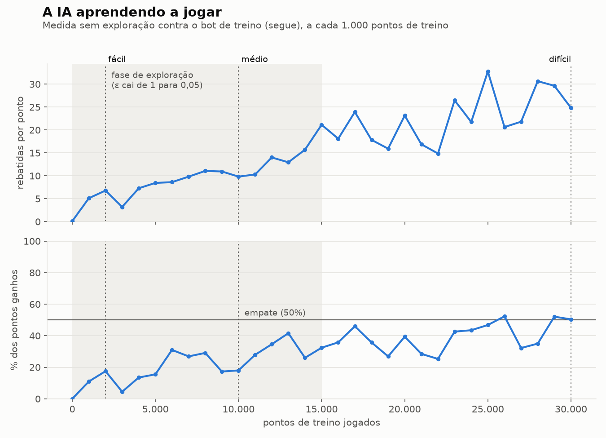
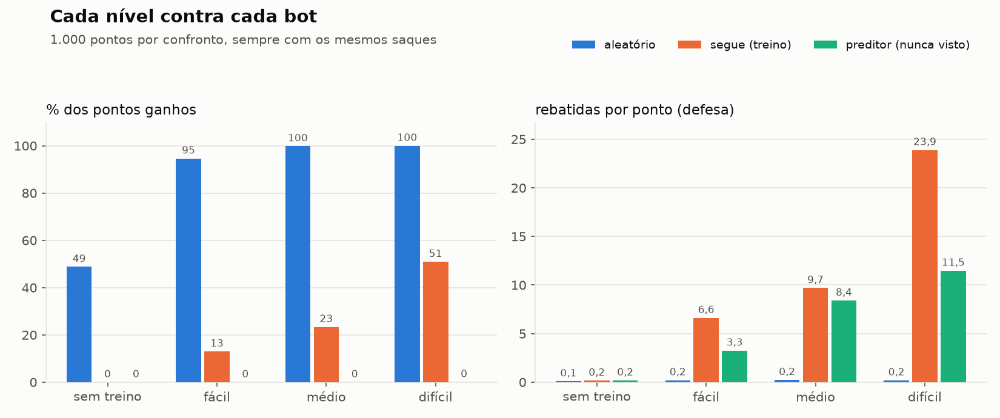

# Relatório de evidências

Gerado por `python -m pong.relatorio`.

## Treino

- Adversário de treino: bot `segue`
- Pontos de treino jogados: 30.000
- Tempo de treino: 5,4 minutos
- Tamanho do "cérebro": 440 estados × 3 ações = 1.320 números (float32) = 5.280 bytes

## Níveis contra os bots

Cada célula: % dos pontos ganhos pela IA · rebatidas por ponto. Pontos que passam de 3.000 passos sem ninguém errar são contados à parte (travados).

| Nível | aleatório | segue (treino) | preditor (nunca visto) |
|---|---|---|---|
| sem treino (0 pontos) | 48,8% · 0,1 | 0,0% · 0,2 | 0,0% · 0,2 |
| fácil (2.000 pontos) | 94,6% · 0,2 | 13,0% · 6,6 | 0,0% · 3,3 |
| médio (10.000 pontos) | 99,8% · 0,2 | 23,4% · 9,7 (17 travados) | 0,0% · 8,4 (1 travado) |
| difícil (30.000 pontos) | 100,0% · 0,2 | 50,9% · 23,9 (313 travados) | 0,1% · 11,5 (57 travados) |

Contra o aleatório quase não há rebatidas porque ele erra logo a primeira devolução. No preditor ninguém marca ponto (nem o bot segue); ali o que mede a IA é a defesa.

